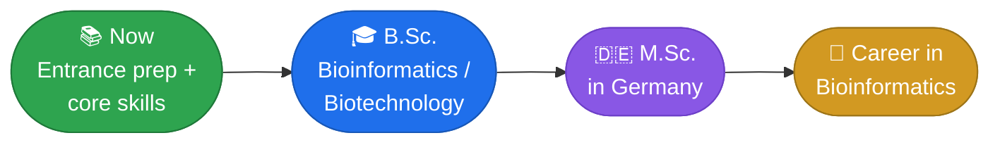

 

---

## 🧬 About

I'm a student preparing for a **B.Sc. in Bioinformatics / Biotechnology**, with a long-term plan to pursue an **M.Sc. in Germany**. I'm learning the computational side of biology early (programming, statistics, genomics and machine learning) and sharing my notes and projects here.

---

## 🗺️ Roadmap

**Side quests:** 🇩🇪 German → B2 · 🇬🇧 IELTS → 7.0+

---

## 🛠️ Tech Stack

---

## 🌱 Currently Learning

Edit the levels so they match where you really are.

| Area | Topics | Level |
|:-----|:-------|:------|
| 💻 Programming | Python, Jupyter, Git/GitHub, Linux/Bash |  |
| 📊 Data analysis | NumPy, Pandas, Matplotlib |  |
| 📐 Math | Statistics, probability, linear algebra |  |
| 🗄️ Databases | SQL |  |
| 🧬 Bioinformatics | FASTA/FASTQ, alignment, BLAST |  |

<b>🔭 Up next (click to expand)</b>

 

- Genomics, NGS and transcriptomics
- Biological databases
- Machine learning and deep learning
- Software / data engineering and modern AI / LLM workflows

---

## 📂 Projects

<!-- Replace this section with real repos. Example pinned-repo cards:

-->

> 🚧 First project in progress. It will appear here when it's ready.

---

<!-- Add this section after a few months of activity, once the numbers look good:

## 📈 GitHub Activity

-->

## 📫 Connect

